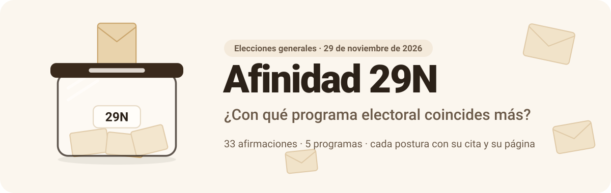
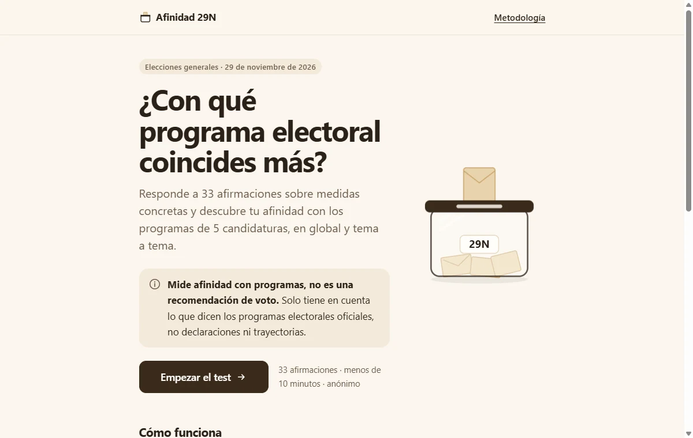
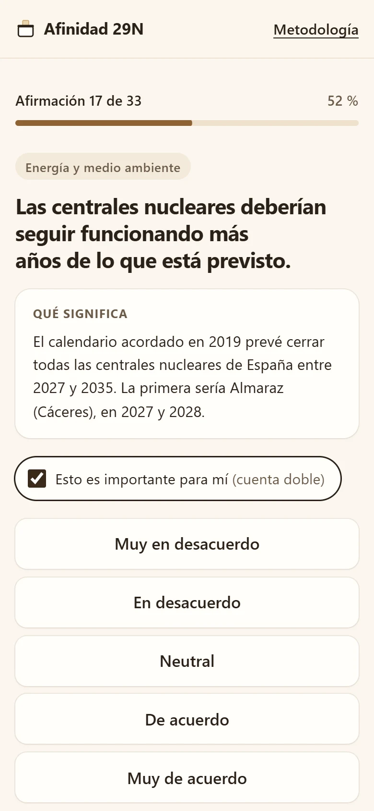
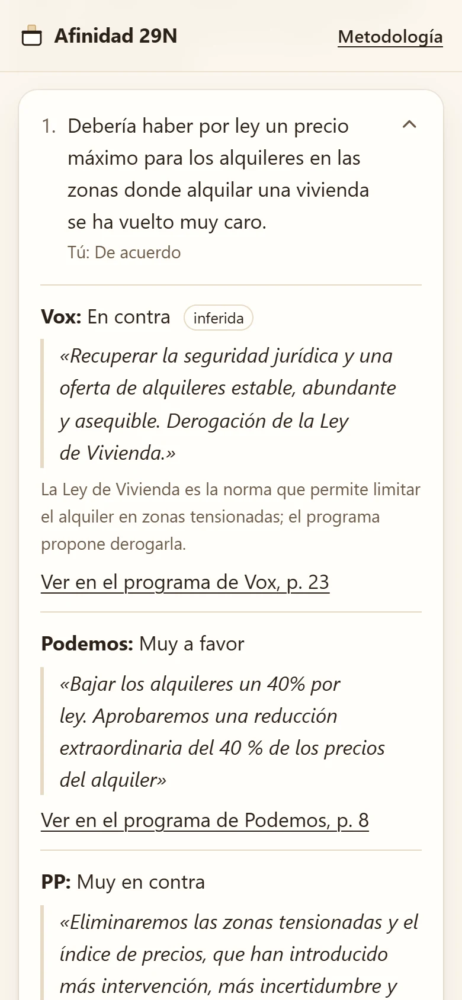
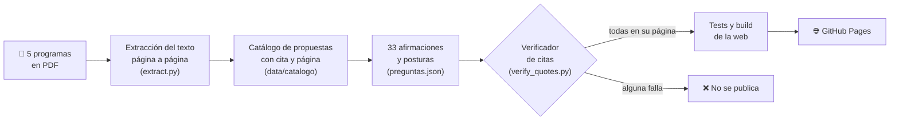

<div align="center">

<picture>
  <source media="(prefers-color-scheme: dark)" srcset="docs/img/banner-oscuro.svg">
  
</picture>

<br>

**Un test neutral para comparar tus ideas con los programas electorales de las elecciones generales del 29 de noviembre de 2026.**
<br>
Cada postura de cada partido está respaldada por una cita literal de su programa, con su página.

<br>

<a href="https://miguelit011.github.io/afinidad-29n/"></a>

<br><br>

[](https://github.com/Miguelit011/afinidad-29n/actions/workflows/deploy.yml)


</div>

> [!IMPORTANT]
> **Mide afinidad con programas, no es una recomendación de voto.** Solo tiene en cuenta lo que dicen los
> programas electorales oficiales, no declaraciones, mítines ni trayectorias.

---

## ✨ Qué es

Respondes a **33 afirmaciones** sobre medidas concretas («Las centrales nucleares deberían seguir funcionando
más años de lo que está previsto») y la web calcula tu afinidad con el programa de cada candidatura, **en global
y tema a tema**. Al final puedes abrir cada afirmación y ver qué dice cada programa, con la cita literal y un
enlace a la página exacta del PDF.

<table>
  <tr>
    <td width="60%" valign="top">
      
      <p align="center"><sub><b>Portada</b> · qué es, cómo funciona y garantías de neutralidad</sub></p>
    </td>
    <td width="20%" valign="top">
      
      <p align="center"><sub><b>Cuestionario</b> · cada afirmación explica qué significa</sub></p>
    </td>
    <td width="20%" valign="top">
      
      <p align="center"><sub><b>Citas</b> · la postura de cada partido, con su página</sub></p>
    </td>
  </tr>
</table>

## 📊 En cifras

<div align="center">
<table>
  <tr>
    <td align="center"><h2>5</h2><sub>programas<br>oficiales</sub></td>
    <td align="center"><h2>536</h2><sub>páginas<br>analizadas</sub></td>
    <td align="center"><h2>13</h2><sub>temas<br>de debate</sub></td>
    <td align="center"><h2>33</h2><sub>afirmaciones<br>concretas</sub></td>
    <td align="center"><h2>280</h2><sub>citas verificadas<br>automáticamente</sub></td>
    <td align="center"><h2>0</h2><sub>datos que salen<br>de tu navegador</sub></td>
  </tr>
</table>
</div>

Programas incluidos: **Frente Amplio, Podemos, PP, PSOE y Vox**. Se eligieron sin un criterio formal y se
podrían añadir otros.

## 🗳️ Cómo funciona

| | Paso | |
|:-:|---|---|
| **1** | **Lees y respondes** | Cinco opciones, de «muy en desacuerdo» a «muy de acuerdo». Puedes saltar una afirmación o marcarla como importante (cuenta doble). |
| **2** | **Se compara con cada programa** | Cada partido tiene una postura de −2 a +2 en cada afirmación, o «no se pronuncia» si su programa no dice nada. |
| **3** | **Ves tu afinidad** | En global y por tema, con la cobertura de cada partido y la cita que respalda cada postura. |

La afinidad con cada partido se calcula solo con las afirmaciones que has respondido y en las que el partido
se pronuncia:

$$\text{afinidad} = \frac{\sum w \cdot \left(1 - \frac{|u - p|}{4}\right)}{\sum w}$$

donde *u* es tu respuesta, *p* la postura del partido (ambas de −2 a +2) y *w* = 2 si la marcaste como
importante (si no, 1). Si un partido se pronuncia en menos del 60 % de tus respuestas, la web avisa de que su
resultado es menos fiable.

## 🛡️ Por qué puedes fiarte

<table>
  <tr>
    <td width="33%" valign="top">
      <h3>⚖️ Neutral</h3>
      <ul>
        <li>16 afirmaciones parten de propuestas de un bloque y 17 del otro.</li>
        <li>Redacción en lenguaje claro y sin palabras cargadas.</li>
        <li>Partidos en orden aleatorio y con el mismo tratamiento.</li>
        <li>Colores de la web sin relación con ningún partido; los logotipos solo los identifican en los resultados.</li>
      </ul>
    </td>
    <td width="33%" valign="top">
      <h3>🔍 Verificable</h3>
      <ul>
        <li>Cada postura tiene una cita literal y su página.</li>
        <li>Un programa comprueba que cada cita está en esa página exacta, y rechaza cualquier cifra cambiada.</li>
        <li>Las posturas deducidas se marcan como «inferidas».</li>
        <li>Todos los datos están en JSON en este repositorio.</li>
      </ul>
    </td>
    <td width="33%" valign="top">
      <h3>🔒 Privado</h3>
      <ul>
        <li>Todo se calcula en tu navegador.</li>
        <li>Sin servidor, cookies, analítica ni almacenamiento.</li>
        <li>La página tiene prohibido enviar datos (<code>connect-src 'none'</code>).</li>
        <li>Sin fuentes ni recursos de terceros.</li>
      </ul>
    </td>
  </tr>
</table>

## 🔄 De los PDF a la web



En cada cambio, GitHub Actions vuelve a extraer el texto de los PDF y comprueba que coincide con el
guardado. Después verifica las 280 citas, ejecuta los 51 tests (pytest y Vitest) y compila la web. **Si algo
falla, la web no se actualiza.**

## 📁 Estructura

```text
afinidad-29n/
├── Programas_Electorales/   Los 5 programas en PDF (la única fuente)
├── pipeline/                Python: extracción, verificador de citas y logotipos
├── data/
│   ├── textos/              Texto de cada PDF por página y huella SHA-256 de cada archivo
│   ├── catalogo/            Propuestas de cada partido, con tema, cita y página
│   └── preguntas.json       Las 33 afirmaciones y la postura de cada partido
├── web/                     La web (Vite + Svelte 5 + TypeScript)
├── docs/img/                Imágenes de este README
└── FASES.md                 Seguimiento del desarrollo y registro de decisiones
```

## 🛠️ Reproducirlo

Requisitos: Python 3.12 o superior y Node 20 o superior.

```bash
# Datos
pip install -r requirements.txt
python pipeline/extract.py          # regenera data/textos/ a partir de los PDF
python pipeline/verify_quotes.py    # comprueba que cada cita está en su página
python -m pytest -q pipeline

# Web
cd web
npm ci
npm test                            # Vitest
npm run dev                         # http://localhost:5173/afinidad-29n/
npm run build                       # genera web/dist/
```

Herramientas para buscar en los programas: `python pipeline/buscar.py "texto"` y
`python pipeline/paginas.py PARTIDO N`. Los logotipos de los resultados se regeneran con
`python pipeline/logos.py`, que los recorta de la contraportada de cada programa.

## 🐞 ¿Ves un error?

Si crees que una postura está mal codificada o que una afirmación está redactada con sesgo, abre una incidencia
con la plantilla **«Error de codificación»**. Indica la afirmación, el partido y la página del PDF que lo demuestra.

<div align="center">

<a href="https://github.com/Miguelit011/afinidad-29n/issues/new?template=error-codificacion.yml"></a>

<br><br>

<sub>La metodología completa, con sus limitaciones, está en la propia web (enlace «Metodología»).</sub>

</div>
